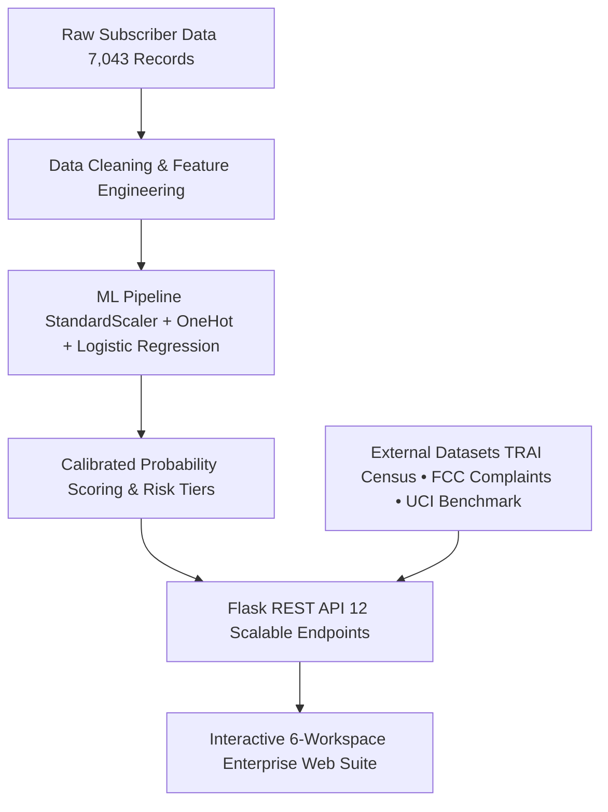

# Customer Churn Prediction & Retention Analytics (CCPRA)

[](https://www.python.org/)
[](https://flask.palletsprojects.com/)
[](https://scikit-learn.org/)
[](https://www.chartjs.org/)
[]()

CCPRA is an end-to-end customer intelligence and retention analytics platform that bridges data science, machine learning, and revenue strategy. It scores individual attrition risks across **7,043 subscribers**, calculates probability-weighted revenue exposure, and provides actionable retention intervention playbooks across six interactive enterprise workspaces.

---

## 📌 Executive Summary

Customer churn is among the most costly operational challenges in telecommunications. Acquiring a new customer costs 5–7× more than retaining an existing one. CCPRA shifts retention from reactive firefighting to proactive, automated, and prioritized outreach.

### Key Portfolio Metrics
- **Total Subscriber Base**: 7,043 accounts (100% verified, 0 missing values)
- **Portfolio Monthly Recurring Revenue (MRR)**: $456,116.60
- **Baseline Churn Rate**: 26.54% (1,869 accounts churned)
- **High-Risk Segment ($P \ge 60\%$)**: 1,039 accounts (14.75%) accounting for **$85,546.25/mo** in exposed MRR (18.76% of total revenue)
- **Expected Monthly Churn Loss**: **$139,980.72 / month** ($\sum P_i \times \text{Charges}_i$)
- **Protected Revenue Scenario**: Retaining just 25% of high-risk customers saves **$21,386.56 / month** ($256,638.75 / year$)

---

## 🏗️ System Architecture



---

## 🖥️ The Six Interactive Workspaces

CCPRA features a unified dark enterprise interface built with Vanilla CSS and Chart.js 4.4, strictly adhering to high-density, restrained data presentation:

1. **Executive Intelligence**:
   - **Portfolio Health Gauge**: Executive score (71.3 / 100) benchmarking churn vs. corporate and industry targets.
   - **Retention Progression Funnel**: 6-stage subscriber drop-off pipeline tracking from total base down to critical outreach.
   - **Service × Contract Matrix**: Interactive 3×3 heat-mapped grid identifying high-risk combinations (Fiber Optic + Month-to-Month at 54.61% churn).

2. **Customer Behavior Lab**:
   - **Multivariate Correlation Matrix**: 7×7 Pearson correlation heatmap isolating tenure ($r = -0.352$) and charges ($r = +0.193$).
   - **Lifecycle Retention Curve**: Cross-sectional survival curve tracking subscriber retention across 72 tenure months.
   - **Tenure & Charges Box Plots**: Five-number quantile distributions highlighting median billing disparities ($79.65 churned vs. $64.43 retained).
   - **Tenure vs. Monthly Charges Scatter**: 700-point stratified sample visualizer.
   - **Outcome Share Proportion**: 100% stacked bar chart with dynamic dimension switching.

3. **Market Intelligence**:
   - **Segment Performance Matrix**: 9-cohort cross-tabulation table with customer counts, churn rates, and high-risk volume.
   - **Segment Bubble Landscape**: 2D scatter visualization scaled by subscriber volume.
   - **TRAI Broadband Census**: Official national census data (1.10B broadband subscribers; Jio 48.9%, Airtel 35.1%).
   - **TRAI MNP Porting Velocity**: Regional state churn volume (15.83M monthly requests; UP East 2.23M, MP 1.53M).
   - **FCC Consumer Complaints**: 5,000 verified grievance tickets categorized across Wireless, Cable, Wired, and VOIP.
   - **External Indian Telco Audit**: Comparative study on 2,026 prepaid records highlighting domain differences and data quality audits.

4. **Revenue Strategy**:
   - **Financial Exposure Treemap**: Hierarchical MRR partitioning by risk tier and contract length.
   - **Revenue Pareto Analysis (80/20 Rule)**: Electronic check accounts for **82.49%** ($70,566.90) of all high-risk MRR exposure.
   - **Threshold Decision Simulator**: Interactive slider ($\tau \in [0.10, 0.90]$) dynamically modeling precision, recall, flagged accounts, and budget impact.
   - **Retention ROI Calculator**: Transparent projections for monthly and annualized protected capital.

5. **Customer Operations**:
   - **Subscriber Explorer**: Full 7,043 customer registry with search, multi-filter dropdowns, column sorting, pagination, and instant CSV export.
   - **Customer Profile Inspector**: Slide-out drawer displaying detailed account history, risk factors, and recommended actions.
   - **Data Provenance Registry**: Complete documentation of sources, licenses, and observation windows for all 5 integrated datasets.

6. **Model Science Lab**:
   - **Real-Time Churn Predictor**: 19-parameter intake form with one-click High-Risk and Low-Risk presets.
   - **Local Feature Attribution**: Waterfall log-odds impact ($\beta_i \times x_i$) showing positive risk elevators and negative protective factors.
   - **Batch CSV Scoring Engine**: Automated schema validation, file dropzone, live inference, and scored CSV export.
   - **Model Evaluation & Diagnostics**: Holdout test benchmarks, Cumulative Gains & Lift curve (2.81× lift at Decile 1), Probability Calibration curve (Brier score 0.1380), Precision-Recall frontier, Confusion Matrix diagnostics, and independent UCI benchmark (98.38% AUC).

---

## 📊 Machine Learning Benchmark

Evaluated on an untouched **20% stratified holdout test split** ($n = 1,409$):

| Evaluation Metric | Logistic Regression (Selected) | Random Forest | Advantage |
|---|:---:|:---:|---|
| **ROC-AUC** | **84.21%** | 81.93% | **+2.28%** superior ranking discrimination |
| **Accuracy** | **80.55%** | 78.71% | **+1.84%** (1,135 / 1,409 correct) |
| **Recall (Catch Rate)** | **55.88%** | 48.93% | **+6.95%** (**+26 additional true churners captured**) |
| **Precision** | **65.72%** | 62.67% | **+3.05%** lower false alarm rate |
| **F1-Score** | **60.40%** | 54.96% | **+5.44%** higher harmonic balance |
| **Brier Reliability Score** | **0.1380** | 0.1512 | Well-calibrated probabilities for revenue loss modeling |
| **Decile 1 Lift Factor** | **2.81×** | 2.54× | Captures 28.07% of churners in top 10% of accounts |

---

## 📁 Multi-Source Datasets

All datasets are verified, locally cached, and maintained with strict domain separation:

| Dataset | Source / Publisher | License | Size | Role in Project |
|---|---|---|---|---|
| **CCPRA Telco Portfolio** | IBM Cognos Analytics | Apache 2.0 | 7,043 rows | Primary customer churn modeling, revenue exposure, and explorer |
| **UCI Telecom Churn** | UCI ML Repository | CC BY 4.0 | 3,150 rows | Independent benchmark on customer service & telemetry features |
| **TRAI Census & MNP** | Telecom Regulatory Authority of India | Open Gov Data | 1.36B subs | National broadband market concentration & regional MNP velocity |
| **FCC Consumer Complaints** | Federal Communications Commission | Public Domain | 5,000 rows | US telecom consumer friction & complaint category breakdown |
| **Mendeley Indian Telco** | Mendeley Data (Patrick Koomson) | CC BY 4.0 | 2,026 rows | Cross-market prepaid benchmark & data anomaly audit |

---

## 🚀 Quick Start Guide

### 1. Setup Environment
```bash
# Clone the repository
git clone https://github.com/SRIHARI-S-2006/SRIHARI-S-2006-DSA-PROJECT-IA3.git
cd SRIHARI-S-2006-DSA-PROJECT-IA3

# Activate virtual environment
.\.venv\Scripts\activate   # Windows
source .venv/bin/activate  # macOS / Linux

# Install dependencies
pip install -r requirements.txt
pip install -r requirements_web.txt
```

### 2. Launch the Web Application
```bash
python website/app.py
```
Open **`http://127.0.0.1:5000`** in your browser.

### 3. Run Automated Browser Verification Suite
```bash
node scratch/verify_major_redesign.mjs
```
Executes headless Chrome verification across all six workspaces, confirming 0 console errors and capturing full-page screenshots in `scratch/workspaces_redesign/`.

---

## 📂 Repository Structure

```text
├── data/
│   ├── raw/original_dataset.csv            # 7,043 raw subscriber records
│   ├── processed/cleaned_customer_churn.csv# Cleaned portfolio master (0 missing values)
│   ├── powerbi/customer_churn_analytics.csv# Scored analytics dataset (32 columns)
│   └── external/                           # TRAI, FCC, UCI, and Mendeley external data
├── models/
│   ├── selected_churn_model.joblib         # Calibrated Logistic Regression pipeline
│   └── model_metadata.json                 # Model hyperparameters & feature list
├── outputs/                                # Analytical charts, tables, and reports
├── scratch/                                # Verification test scripts (CDP test runners)
├── src/                                    # Pipeline scripts (cleaning, EDA, training, scoring)
├── website/
│   ├── static/app.js                       # Chart.js configs & interactivity
│   ├── static/style.css                    # Enterprise dark theme design system
│   ├── templates/index.html                # Semantic HTML for all 6 workspaces
│   └── app.py                              # Flask backend with 12 REST API endpoints
├── requirements.txt                        # Core data science dependencies
├── requirements_web.txt                    # Web server dependencies
└── README.md                               # Project documentation
```

---

## 🎯 Operational Retention Playbooks

| Risk Tier | Probability Range | Action Priority | Recommended Intervention |
|---|:---:|:---:|---|
| **Critical Triage** | $P \ge 80\%$ (49 accounts) | Priority 1 (Urgent) | Outbound senior agent call; 1-year renewal credit; free tech support package |
| **High Risk Base** | $60\% \le P < 80\%$ (990 accounts) | Priority 2 (High) | Target contract upgrade incentive; promote automated payment discount |
| **Medium Risk** | $30\% \le P < 60\%$ (1,720 accounts) | Priority 3 (Medium) | Digital email nurture campaign; trial of online security & backup services |
| **Low Risk** | $P < 30\%$ (4,284 accounts) | Priority 4 (Low) | Standard loyalty communications; multi-line cross-sell offers |

---

## 📜 License & Citations

- **Code**: [MIT License](LICENSE)
- **Primary Data**: IBM Cognos Analytics Open Dataset
- **UCI Dataset**: [UCI Machine Learning Repository](https://archive.ics.uci.edu/dataset/563/iranian+churn+dataset)
- **TRAI Reports**: [Telecom Regulatory Authority of India](https://www.trai.gov.in)
- **FCC Data**: [FCC Consumer Complaints Open Data](https://opendata.fcc.gov)
- **Mendeley Data**: [DOI: 10.17632/px3dt72xdw.1](https://data.mendeley.com/datasets/px3dt72xdw/1)
